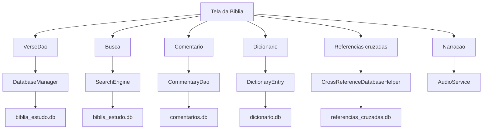

# Fluxo de leitura e estudo

## Etapa 1. Leitura

A tela da Bíblia consulta o `VerseDao`, que usa o `DatabaseManager` para
falar com `biblia_estudo.db`.

## Etapa 2. Busca

`SearchEngine` percorre os versículos e devolve os resultados por assunto.

## Etapa 3. Estudo

Comentários, dicionário e referências cruzadas vêm de bancos separados, cada
um com seu próprio helper e seu próprio DAO.

## Etapa 4. Anotações

Favoritos, notas, destaques e progresso de leitura são gravados no mesmo
banco principal, por isso aparecem junto ao versículo.

## Etapa 5. Narração

`AudioService` lê o versículo em voz alta quando o usuário pede.
